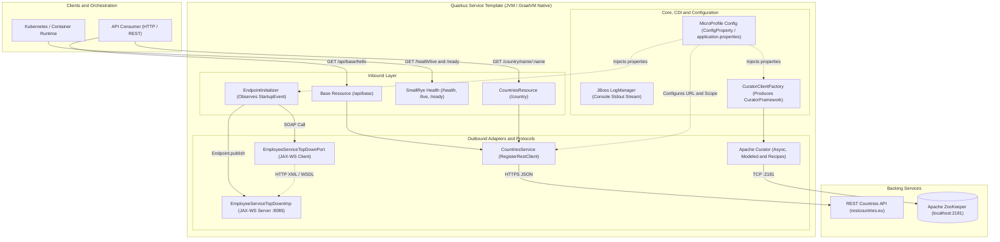
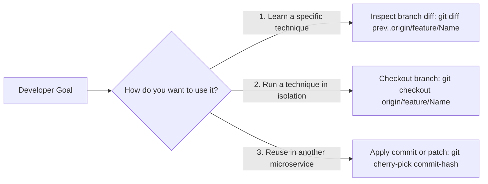
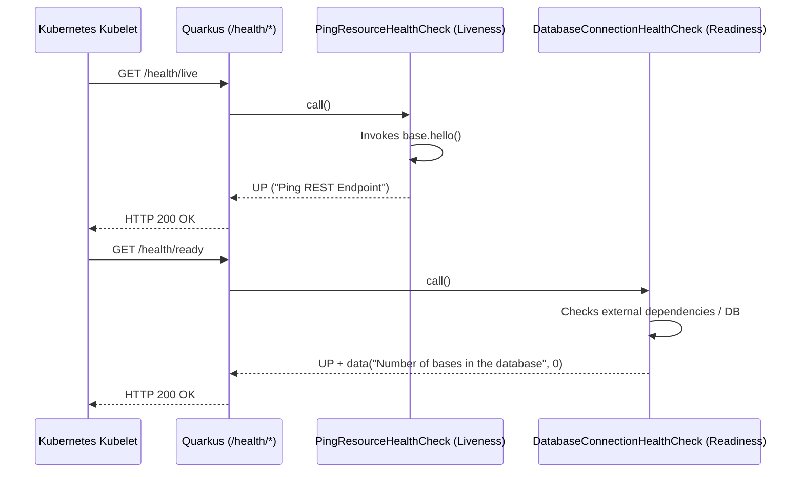
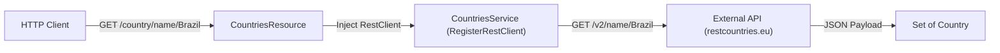
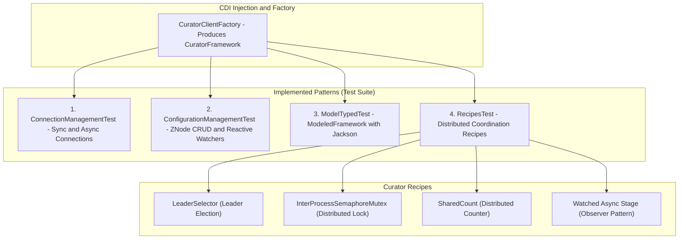
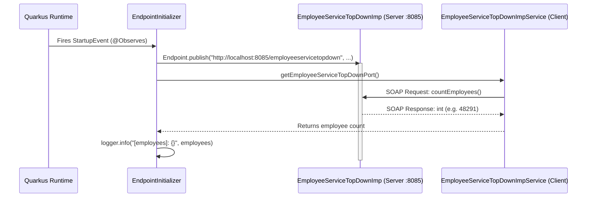

# Quarkus 12-Factor Microservice Template

Architectural reference template for building Java microservices with **Quarkus** adhering to **[The Twelve-Factor App](https://12factor.net/)** methodology.

> [!IMPORTANT]
> **Repository Philosophy (Isolated Technique per Branch):**
> This project is structured **incrementally and evolutionarily**. Each engineering technique, Quarkus extension, or integration pattern is implemented in isolation within its own dedicated branch (`feature/*`). This makes it straightforward to inspect the exact `git diff` of a single capability, understand its mechanics without noise from unrelated components, and replicate the recipe in new microservices.

---

## Table of Contents

1. [Overview and Consolidated Architecture](#1-overview-and-consolidated-architecture)
2. [Branch Evolution Map](#2-branch-evolution-map)
3. [Twelve-Factor App Alignment](#3-twelve-factor-app-alignment)
4. [How to Use This Repository (Practical Git Guide)](#4-how-to-use-this-repository-practical-git-guide)
5. [Detailed Technique Catalog by Branch](#5-detailed-technique-catalog-by-branch)
   - [5.1. `feature/BaseRest` — REST Bootstrap, Docker & CI/CD](#51-featurebaserest--rest-bootstrap-docker--cicd)
   - [5.2. `feature/Health` — Observability: Liveness & Readiness Probes](#52-featurehealth--observability-liveness--readiness-probes)
   - [5.3. `feature/RestClient` — Declarative HTTP Integration (MP Rest Client)](#53-featurerestclient--declarative-http-integration-mp-rest-client)
   - [5.4. `feature/Log` — Telemetry and Stdout Log Standardization](#54-featurelog--telemetry-and-stdout-log-standardization)
   - [5.5. `feature/checkstyle` — Static Code Governance (Google Style)](#55-featurecheckstyle--static-code-governance-google-style)
   - [5.6. `feature/zookeeper` — Distributed Coordination with Apache Curator](#56-featurezookeeper--distributed-coordination-with-apache-curator)
   - [5.7. `feature/Config` — Configuration Injection & Externalization](#57-featureconfig--configuration-injection--externalization)
   - [5.8. `feature/wssoap` — Top-Down SOAP Interoperability (JAX-WS)](#58-featurewssoap--top-down-soap-interoperability-jax-ws)
6. [Building, Running, and Testing](#6-building-running-and-testing)

---

## 1. Overview and Consolidated Architecture

On the `master` branch, all techniques isolated across the thematic feature branches are merged into a single cohesive service. The diagram below illustrates the resulting component topology:



### Core Technology Stack
| Component | Technology / Specification | Template Version |
| :--- | :--- | :--- |
| **Runtime Framework** | Quarkus (`quarkus-bom`) | `1.3.0.Final` |
| **Target Language** | Java SE | `1.8` (GraalVM Native Compatible) |
| **REST Layer** | RESTEasy JAX-RS + JSON-B (`quarkus-resteasy`, `quarkus-resteasy-jsonb`) | `1.3.0.Final` |
| **HTTP Client** | Eclipse MicroProfile REST Client (`quarkus-rest-client`) | `1.3.0.Final` |
| **Health Checks** | Eclipse MicroProfile Health (`quarkus-smallrye-health`) | `1.3.0.Final` |
| **Distributed Coordination** | Apache Curator (`curator-x-async`, `curator-recipes`) + ZooKeeper | `4.3.0` / `3.4.14` |
| **Legacy Web Services** | JAX-WS (`javax.xml.ws.Endpoint` / `wsimport`) | JDK Standard |
| **Code Quality & Style** | Maven Checkstyle Plugin (Google Java Style) | `3.1.1` |
| **Testing** | JUnit 5 (`@QuarkusTest`), REST Assured, AssertJ, Awaitility | `2.22.1` (Surefire) |

---

## 2. Branch Evolution Map

The evolution graph below shows how each `feature/*` branch builds upon the previous milestone before converging into `master`. Each node represents an isolated technical recipe that can be inspected independently:

```mermaid
flowchart LR
    INIT(["5a3798e - Init repo"]) --> BR["feature/BaseRest (c38a61d) - REST, Docker, Jenkins"]
    BR --> HL["feature/Health (eefe9bd) - Liveness and Readiness"]
    HL --> RC["feature/RestClient (417a7f9) - MP RestClient and JSON-B"]
    RC --> LG["feature/Log (b5864d5) - Stdout Logging"]
    LG --> CS["feature/checkstyle (ad24e18) - Google Java Style"]
    CS --> ZK_BASE["362a972 - Curator and ZooKeeper"]

    ZK_BASE --> ZK["feature/zookeeper (6beea15) - CuratorClientFactory and Recipes"]
    ZK_BASE --> CFG_BASE["1e42602 - Config Example"]

    ZK --> MRG1(["07349a2 - Merge base"])
    CFG_BASE --> MRG1
    MRG1 --> CFG["feature/Config (d838e94) - ConfigProperty"]

    CFG_BASE --> SOAP["feature/wssoap (c2c2ebf) - JAX-WS Server and Client"]

    SOAP --> MASTER(["master (ae94f4e) - Consolidated Template"])
    CFG --> MASTER
```



### Quick Branch Reference

| Remote Branch | Target Commit | Isolated Technique / Capability | Isolated Diff Command |
| :--- | :---: | :--- | :--- |
| `origin/feature/BaseRest` | `c38a61d` | Quarkus scaffolding, RESTEasy, Dockerfiles (JVM/Native), and CI/CD Pipeline (`Jenkinsfile`). | `git show c38a61d` |
| `origin/feature/Health` | `eefe9bd` | Liveness and Readiness probes with SmallRye Health for container orchestrators (K8s). | `git diff c38a61d..eefe9bd` |
| `origin/feature/RestClient` | `417a7f9` | Declarative consumption of external REST APIs via MicroProfile RestClient and JSON-B. | `git diff eefe9bd..417a7f9` |
| `origin/feature/Log` | `b5864d5` | Standardized console (`stdout`) log stream configuration and severity level policy. | `git diff 417a7f9..b5864d5` |
| `origin/feature/checkstyle` | `ad24e18` | Strict enforcement of the Google Java Style Guide during the Maven `validate` phase. | `git diff b5864d5..ad24e18` |
| `origin/feature/zookeeper` | `6beea15` | Distributed coordination, dynamic configuration, typed models, and recipes with Apache Curator. | `git diff ad24e18..6beea15` |
| `origin/feature/Config` | `d838e94` | Property externalization using `@ConfigProperty` and safe `defaultValue` fallbacks. | `git diff 362a972..d838e94` |
| `origin/feature/wssoap` | `c2c2ebf` | Top-Down (WSDL) SOAP Web Service publishing and consumption tied to the Quarkus lifecycle. | `git show c2c2ebf` |

---

## 3. Twelve-Factor App Alignment

This project translates the principles of the **Twelve-Factor App** methodology into concrete code and infrastructure practices:

| Factor | 12-Factor Principle | Implementation in Template | Reference Branch |
| :---: | :--- | :--- | :--- |
| **I** | **Codebase** | Single Git repository tracked with a declarative pipeline in [`Jenkinsfile`](Jenkinsfile). | `feature/BaseRest` |
| **II** | **Dependencies** | Explicit dependency declaration via Maven BOM ([`pom.xml`](pom.xml)) and isolated build via Maven Wrapper (`./mvnw`). | `feature/BaseRest` |
| **III** | **Config** | Configuration injected via `@ConfigProperty` and externalized in [`application.properties`](src/main/resources/application.properties), environment variables, or ZooKeeper. | `feature/Config` / `feature/zookeeper` |
| **IV** | **Backing Services** | External services (Countries REST API, ZooKeeper, SOAP Endpoint) treated as attached resources bound via configurable URLs. | `feature/RestClient` / `feature/zookeeper` / `feature/wssoap` |
| **V** | **Build, Release, Run** | Strict separation in [`Jenkinsfile`](Jenkinsfile): binary compilation, Docker image packaging ([`Dockerfile.jvm`](src/main/docker/Dockerfile.jvm) / [`Dockerfile.native`](src/main/docker/Dockerfile.native)), and AWS ECR release. | `feature/BaseRest` / `feature/checkstyle` |
| **VI** | **Processes** | Stateless and share-nothing service; shared state, counters, and locks are delegated to Apache ZooKeeper. | `feature/BaseRest` / `feature/zookeeper` |
| **VII** | **Port Binding** | Self-contained runtime with embedded Undertow/Vert.x exposed on port `8080` (HTTP) and JAX-WS on port `8085`. | `feature/BaseRest` / `feature/wssoap` |
| **IX** | **Disposability** | Sub-second startup and graceful shutdown native to Quarkus, paired with `/health/live` and `/health/ready` probes. | `feature/Health` |
| **X** | **Dev/Prod Parity** | Live Coding (`quarkus:dev`), standardized containers, automated style verification, and integration testing. | `feature/BaseRest` / `feature/checkstyle` |
| **XI** | **Logs** | Logs treated as event streams routed directly to `stdout` without local log file management. | `feature/Log` |

---

## 4. How to Use This Repository (Practical Git Guide)

Because the main goal of this repository is to serve as a **living catalog of isolated techniques**, there are three primary workflows for exploring it:



### Scenario A: Inspect the exact changes required to implement a technique
To view only the source files, `pom.xml` dependencies, and configuration properties introduced by a specific technique without noise from others:

```bash
# Example 1: See exactly how Health Checks were added on top of BaseRest
git diff origin/feature/BaseRest..origin/feature/Health

# Example 2: See exactly how the Declarative REST Client was implemented
git diff origin/feature/Health..origin/feature/RestClient

# Example 3: Inspect the files added for SOAP Web Services
git show --stat origin/feature/wssoap
```

### Scenario B: Check out the project state at a specific evolutionary stage
If you want to run the project containing **only** the features accumulated up to a given branch:

```bash
# List all available remote branches
git branch -r

# Checkout a local branch tracking the desired stage
git checkout -b study-restclient origin/feature/RestClient
```

### Scenario C: Transplant a technique into your own project
You can extract a patch or cherry-pick a specific commit to apply its structure to another repository:

```bash
# Generate a patch file for the Checkstyle configuration
git format-patch -1 origin/feature/checkstyle
```

---

## 5. Detailed Technique Catalog by Branch

Below is the technical breakdown for each branch, explaining **what problem it solves**, **how it is implemented**, and **how to reproduce it step by step**.

---

### 5.1. `feature/BaseRest` — REST Bootstrap, Docker & CI/CD

- **Branch:** `origin/feature/BaseRest` (Commit `c38a61d`)
- **Goal:** Scaffold the Quarkus microservice with a basic JAX-RS endpoint, integration tests, Docker image definitions (JVM and Native), and a CI/CD pipeline.

#### How to reproduce from scratch
```bash
mvn io.quarkus:quarkus-maven-plugin:1.3.0.Final:create \
    -DprojectGroupId=com.v2com.iws10.axon.template-service \
    -DprojectArtifactId=quarkus-12factor-service-template \
    -DclassName="com.v2com.iws10.axon.template.service.Base" \
    -Dpath="api/base"
```

#### Key Artifacts
- **REST Endpoint ([`Base.java`](src/main/java/com/v2com/iws10/axon/template/service/Base.java)):** Exposes `GET /api/base/hello` returning plain text (`hello`).
- **Automated Tests ([`BaseTest.java`](src/test/java/com/v2com/iws10/axon/template/service/BaseTest.java) & [`NativebaseIT.java`](src/test/java/com/v2com/iws10/axon/template/service/NativebaseIT.java)):** Validation with `@QuarkusTest` (JVM) and `@NativeImageTest` (native binary) using `RestAssured`.
- **Containerization ([`Dockerfile.jvm`](src/main/docker/Dockerfile.jvm) & [`Dockerfile.native`](src/main/docker/Dockerfile.native)):** Container images built on `fabric8/java-alpine-openjdk8-jre` and `registry.access.redhat.com/ubi8/ubi-minimal`.
- **CI/CD Pipeline ([`Jenkinsfile`](Jenkinsfile)):** 6-stage declarative pipeline: `Build` -> `Verify code` -> `Docker image build` -> `Perform Tests` -> `Deploy docker images` (AWS ECR) -> `Sonar`.

---

### 5.2. `feature/Health` — Observability: Liveness & Readiness Probes

- **Branch:** `origin/feature/Health` (Commit `eefe9bd`)
- **Inspection Diff:** `git diff origin/feature/BaseRest..origin/feature/Health`
- **Goal:** Expose standardized Eclipse MicroProfile Health probes so container orchestrators (such as Kubernetes) know when to restart the container (*Liveness*) or when to route traffic to it (*Readiness*).



#### How to add to the project
```bash
./mvnw quarkus:add-extension -Dextensions="health"
```

#### Implementation
1. **Liveness Probe ([`PingResourceHealthCheck.java`](src/main/java/com/v2com/iws10/axon/template/service/PingResourceHealthCheck.java)):** Annotated with `@Liveness` and `@ApplicationScoped`, implements `HealthCheck` to verify that internal application components are responsive.
2. **Readiness Probe ([`DatabaseConnectionHealthCheck.java`](src/main/java/com/v2com/iws10/axon/template/service/DatabaseConnectionHealthCheck.java)):** Annotated with `@Readiness`, validates external dependencies (databases, brokers, etc.) and attaches diagnostic metadata via `.withData(...)`.
3. **Automatically Exposed Endpoints:**
   - `http://localhost:8080/health/live` — Liveness status.
   - `http://localhost:8080/health/ready` — Readiness status.
   - `http://localhost:8080/health` — Aggregated health report (Liveness + Readiness).

---

### 5.3. `feature/RestClient` — Declarative HTTP Integration (MP Rest Client)

- **Branch:** `origin/feature/RestClient` (Commit `417a7f9`)
- **Inspection Diff:** `git diff origin/feature/Health..origin/feature/RestClient`
- **Goal:** Consume external REST services in a type-safe, declarative way using interfaces annotated with MicroProfile REST Client and automatic JSON-B deserialization.



#### How to add to the project
```bash
./mvnw quarkus:add-extension -Dextensions="rest-client,resteasy-jsonb"
```

#### Step-by-Step Implementation
1. **Domain Model ([`Country.java`](src/main/java/com/v2com/iws10/axon/template/service/model/Country.java)):** POJO mapping the JSON fields returned by the external API (`name`, `alpha2Code`, `capital`, `currencies`).
2. **Declarative Client Interface ([`CountriesService.java`](src/main/java/com/v2com/iws10/axon/template/service/client/CountriesService.java)):**
   ```java
   @Path("/v2")
   @RegisterRestClient(configKey = "country-api")
   public interface CountriesService {
     @GET
     @Path("/name/{name}")
     @Produces("application/json")
     Set<Country> getByName(@PathParam String name);
   }
   ```
3. **Injection and Exposure ([`CountriesResource.java`](src/main/java/com/v2com/iws10/axon/template/service/CountriesResource.java) and [`Base.java`](src/main/java/com/v2com/iws10/axon/template/service/Base.java)):** Inject the client interface via `@Inject @RestClient CountriesService countriesService;`.
4. **Externalized Configuration ([`application.properties`](src/main/resources/application.properties)):**
   ```properties
   country-api/mp-rest/url=https://restcountries.eu/rest
   country-api/mp-rest/scope=javax.inject.Singleton
   ```

> [!NOTE]
> In commit `362a972`, `@RegisterRestClient(configKey = "country-api")` was adopted to simplify the property prefix in `application.properties` instead of requiring the interface's Fully Qualified Name (FQN).

---

### 5.4. `feature/Log` — Telemetry and Stdout Log Standardization

- **Branch:** `origin/feature/Log` (Commit `b5864d5`)
- **Inspection Diff:** `git diff origin/feature/RestClient..origin/feature/Log`
- **Goal:** Fulfill **Factor XI (Logs)** of the 12-Factor App by ensuring the application writes formatted event streams to standard output (`stdout`) and establishing a clear severity policy across the engineering team.

#### Configuration ([`application.properties`](src/main/resources/application.properties))
```properties
quarkus.log.console.enable=true
quarkus.log.console.format=%d{HH:mm:ss} %-5p [%c{2.}] (%t) %s%e%n
quarkus.log.console.level=DEBUG
quarkus.log.console.color=true
```

#### Log Level Governance Matrix
| Level | Weight | Technical Description | Engineering Usage Guideline |
| :--- | :---: | :--- | :--- |
| **`ALL`** | `MAX_VALUE` | All levels including custom levels. | Do not use directly in application code. |
| **`TRACE`** | `600` | Finer-grained informational events than `DEBUG`. | Use to trace execution paths or inflection points in code presenting aggregated data. |
| **`DEBUG`** | `500` | Fine-grained events aimed at debugging an application. | **Use at every relevant inflection point in the system.** |
| **`INFO`** | `400` | Coarse-grained informational messages highlighting application progress. | Use to record passage through major milestones and key state transitions. |
| **`WARN`** | `300` | Potentially harmful or anomalous situations. | **Mandatory** whenever a `try..catch` block suppresses an error without rethrowing an exception. |
| **`ERROR`** | `200` | Error events that might still allow the application to continue running. | **Mandatory** whenever throwing or handling an operational exception. |
| **`FATAL`** | `100` | Severe error events that presumably lead the application to abort. | Not directly supported by the underlying logger version in use. |
| **`OFF`** | `0` | Highest possible rank; turns off logging entirely. | Configuration-only suppression. |

---

### 5.5. `feature/checkstyle` — Static Code Governance (Google Style)

- **Branch:** `origin/feature/checkstyle` (Commit `ad24e18`)
- **Inspection Diff:** `git diff origin/feature/Log..origin/feature/checkstyle`
- **Goal:** Enforce automated static code formatting and conventions during the Maven `validate` lifecycle phase using a customized **Google Java Style Guide** ([`checkstyle.xml`](checkstyle.xml)), failing the build (`failsOnError=true`) on violations.

#### Style Rules and IDE Configuration
1. **Indentation:** 2 spaces (`tabWidth = 2`, `basicOffset = 2`).
2. **No Wildcard Imports (`AvoidStarImport`):** Configure your IDE to only use `*` imports when the class count exceeds `9999`.
3. **Strict Import Ordering (`CustomImportOrder`):**
   ```text
   1. import static (all static imports in alphabetical order)
   <blank line>
   2. Third-party and project imports (e.g., com.*, io.*)
   3. import java.*
   4. import javax.*
   5. import org.*
   ```

#### Manual Execution
```bash
# Run Checkstyle verification
./mvnw checkstyle:check

# Or skip temporarily during fast local test cycles:
./mvnw test -Dcheckstyle.skip=true
```

---

### 5.6. `feature/zookeeper` — Distributed Coordination with Apache Curator

- **Branch:** `origin/feature/zookeeper` (Commits `362a972` and `6beea15`)
- **Inspection Diff:** `git diff origin/feature/checkstyle..origin/feature/zookeeper`
- **Goal:** Demonstrate distributed systems coordination patterns using **Apache ZooKeeper** and **Apache Curator** (`curator-x-async` and `curator-recipes`), keeping the microservice processes themselves stateless (Factor VI).



#### Catalog of Implementations (Located in `src/test/java/.../zookeeper/`)

| Class | Demonstrated Technique | Description |
| :--- | :--- | :--- |
| [`CuratorClientFactory.java`](src/test/java/com/v2com/iws10/axon/template/service/zookeeper/CuratorClientFactory.java) | **CDI Producer (`@Produces`)** | Encapsulates the retry policy (`RetryNTimes`) and produces `CuratorFramework` instances configured via `@ConfigProperty(name = "zookeeper.address")`. |
| [`ConnectionManagementTest.java`](src/test/java/com/v2com/iws10/axon/template/service/zookeeper/ConnectionManagementTest.java) | **Connection Management** | Traditional synchronous connection and non-blocking/blocking asynchronous wrappers via `AsyncCuratorFramework` (`thenAccept` vs `thenAcceptAsync`). |
| [`ConfigurationManagementTest.java`](src/test/java/com/v2com/iws10/axon/template/service/zookeeper/ConfigurationManagementTest.java) | **Dynamic Config & Watchers** | ZNode creation, asynchronous payload writes, and reactive event triggers using `async.watched().getData()`. |
| [`ModelTypedTest.java`](src/test/java/com/v2com/iws10/axon/template/service/zookeeper/ModelTypedTest.java) | **Strongly-Typed ZNodes** | Transparent JSON serialization/deserialization of the [`HostConfig.java`](src/main/java/com/v2com/iws10/axon/template/service/model/HostConfig.java) POJO at `/config/app` using `ModeledFramework` and `JacksonModelSerializer`. |
| [`RecipesTest.java`](src/test/java/com/v2com/iws10/axon/template/service/zookeeper/RecipesTest.java) | **Coordination Recipes** | 1. **Leader Election** (`LeaderSelector`)<br/>2. **Distributed Lock** (`InterProcessSemaphoreMutex`)<br/>3. **Shared Counter** (`SharedCount`)<br/>4. **Change Observer** (`async.watched()`) |

> [!WARNING]
> The tests in the `zookeeper` package connect to a live ZooKeeper instance at `localhost:2181` (configured via `zookeeper.address`). To run them locally, start a ZooKeeper container before running `./mvnw test`:
> ```bash
> docker run -d --name zookeeper-dev -p 2181:2181 zookeeper:3.4.14
> ```

---

### 5.7. `feature/Config` — Configuration Injection & Externalization

- **Branch:** `origin/feature/Config` (Commits `1e42602` and `d838e94`)
- **Inspection Diff:** `git diff 362a972..origin/feature/Config`
- **Goal:** Implement **Factor III (Config)** by decoupling environment parameters from source code using Eclipse MicroProfile Config (`@ConfigProperty`), including safe fallback defaults.

#### Implementation Pattern ([`CuratorClientFactory.java`](src/test/java/com/v2com/iws10/axon/template/service/zookeeper/CuratorClientFactory.java))
```java
@ConfigProperty(name = "zookeeper.address", defaultValue = "localhost:2181")
String zookeeperAddress;
```

And in [`application.properties`](src/main/resources/application.properties):
```properties
# Zookeeper server configuration
zookeeper.address=localhost:2181
```

> [!TIP]
> **Runtime Override Precedence (12-Factor):** Any property defined in `application.properties` can be overridden at runtime without rebuilding the binary via:
> - **Environment Variables:** `ZOOKEEPER_ADDRESS=zk-prod:2181`
> - **JVM System Properties:** `-Dzookeeper.address=zk-prod:2181`

---

### 5.8. `feature/wssoap` — Top-Down SOAP Interoperability (JAX-WS)

- **Branch:** `origin/feature/wssoap` (Commit `c2c2ebf`)
- **Inspection Diff:** `git show origin/feature/wssoap`
- **Goal:** Demonstrate how to publish a SOAP Web Service server and consume a SOAP endpoint from an existing WSDL contract (*Top-Down / Contract-First*) during the Quarkus startup lifecycle.



#### 1. Generating Server Classes from WSDL
Given the contract [`employeeservicetopdown_server.wsdl`](src/main/resources/employeeservicetopdown_server.wsdl), generate the JAX-WS artifacts using the JDK `wsimport` tool:

```bash
$JAVA_HOME/bin/wsimport -s src/main/java/ \
    -p com.v2com.iws10.axon.template.service.soap.server \
    src/main/resources/employeeservicetopdown_server.wsdl
```
- Implement the generated service interface as shown in [`EmployeeServiceTopDownImp.java`](src/main/java/com/v2com/iws10/axon/template/service/soap/server/EmployeeServiceTopDownImp.java).
- Publish the endpoint by observing Quarkus's `StartupEvent` in [`EndpointInitializer.java`](src/main/java/com/v2com/iws10/axon/template/service/soap/EndpointInitializer.java).

#### 2. Generating Client Classes from WSDL
With the SOAP server running (since `wsimport` resolves the `<xsd:import schemaLocation="..."/>` URL referenced in [`employeeservicetopdown_client.wsdl`](src/main/resources/employeeservicetopdown_client.wsdl)), run:

```bash
$JAVA_HOME/bin/wsimport -s src/main/java/ \
    -p com.v2com.iws10.axon.template.service.soap.client \
    src/main/resources/employeeservicetopdown_client.wsdl
```

---

## 6. Building, Running, and Testing

### Development Mode (Live Coding)
Starts Quarkus in dev mode listening on port `8080` (HTTP) and publishes the SOAP service on port `8085`, hot-reloading code and resource changes on the fly:

```bash
./mvnw quarkus:dev
```

#### Locally Available Endpoints
| Method | URL | Description | Source Branch |
| :---: | :--- | :--- | :--- |
| `GET` | `http://localhost:8080/` | Static welcome page ([`index.html`](src/main/resources/META-INF/resources/index.html)) | `feature/BaseRest` |
| `GET` | `http://localhost:8080/api/base/hello` | Basic greeting endpoint (`text/plain`) | `feature/BaseRest` |
| `GET` | `http://localhost:8080/api/base/countries/{name}` | Country lookup via REST Client (`.toString()` output) | `feature/RestClient` |
| `GET` | `http://localhost:8080/country/name/{name}` | Country lookup via REST Client (`application/json` output) | `feature/RestClient` |
| `GET` | `http://localhost:8080/health` | Aggregated application health status | `feature/Health` |
| `GET` | `http://localhost:8080/health/live` | Liveness probe | `feature/Health` |
| `GET` | `http://localhost:8080/health/ready` | Readiness probe | `feature/Health` |
| `GET` | `http://localhost:8085/employeeservicetopdown?wsdl` | WSDL contract of the SOAP server published at startup | `feature/wssoap` |

### Packaging and Running in Production (JVM)
```bash
# Compile and package the executable runner JAR (skipping tests if local ZooKeeper is not running)
./mvnw clean package -DskipTests

# Run the generated artifact (dependencies are copied to target/lib/)
java -jar target/quarkus-12factor-service-template-1.0-SNAPSHOT-runner.jar
```

### Building a Native Executable (GraalVM)
```bash
# Requires GraalVM installed or container build (-Dquarkus.native.container-build=true)
./mvnw package -Pnative -DskipTests

# Execute the native binary directly
./target/quarkus-12factor-service-template-1.0-SNAPSHOT-runner
```
