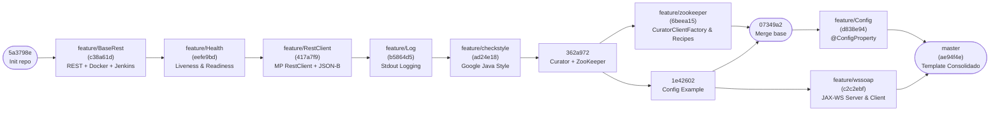
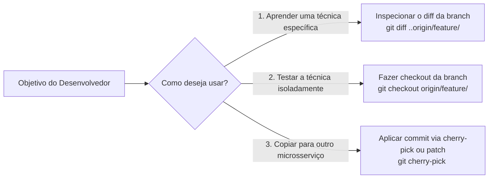
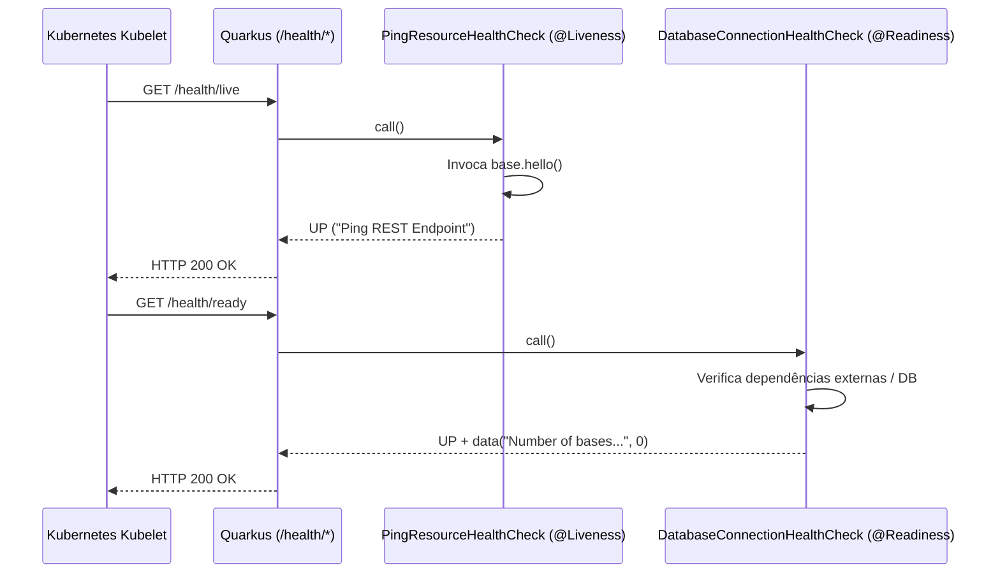
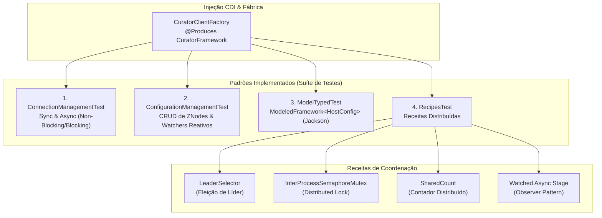
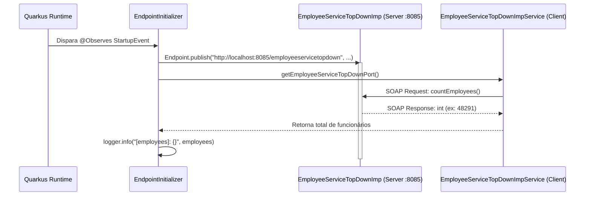

# Quarkus 12-Factor Microservice Template

Template de referência arquitetural para construção de microsserviços Java baseados em **Quarkus** aderentes à metodologia **[The Twelve-Factor App](https://12factor.net/)**.

> [!IMPORTANT]
> **Filosofia do Repositório (Aprendizado e Reuso por Isolamento em Branches):**
> Este projeto foi estruturado de forma **incremental e evolutiva**. Cada técnica de engenharia, extensão ou padrão de integração foi implementado isoladamente em sua própria *branch* (`feature/*`). Isso permite inspecionar o *diff* exato de cada capacidade (`git diff`), compreender o racional sem ruído de outros componentes e replicar a receita diretamente em novos serviços.

---

## Sumário

1. [Visão Geral e Arquitetura](#1-visão-geral-e-arquitetura)
2. [Mapa Evolutivo das Branches](#2-mapa-evolutivo-das-branches)
3. [Aderência ao 12-Factor App](#3-aderência-ao-12-factor-app)
4. [Como Usar Este Repositório (Guia Prático de Git)](#4-como-usar-este-repositório-guia-prático-de-git)
5. [Catálogo Detalhado de Técnicas por Branch](#5-catálogo-detalhado-de-técnicas-por-branch)
   - [5.1. `feature/BaseRest` — Bootstrap REST, Docker & CI/CD](#51-featurebaserest--bootstrap-rest-docker--cicd)
   - [5.2. `feature/Health` — Observabilidade: Liveness & Readiness](#52-featurehealth--observabilidade-liveness--readiness)
   - [5.3. `feature/RestClient` — Integração HTTP Declarativa (MP Rest Client)](#53-featurerestclient--integração-http-declarativa-mp-rest-client)
   - [5.4. `feature/Log` — Telemetria e Padronização de Logs em Stdout](#54-featurelog--telemetria-e-padronização-de-logs-em-stdout)
   - [5.5. `feature/checkstyle` — Governança Estática de Código (Google Style)](#55-featurecheckstyle--governança-estática-de-código-google-style)
   - [5.6. `feature/zookeeper` — Coordenação Distribuída com Apache Curator](#56-featurezookeeper--coordenação-distribuída-com-apache-curator)
   - [5.7. `feature/Config` — Injeção e Externalização de Configuração](#57-featureconfig--injeção-e-externalização-de-configuração)
   - [5.8. `feature/wssoap` — Interoperabilidade SOAP Top-Down (JAX-WS)](#58-featurewssoap--interoperabilidade-soap-top-down-jax-ws)
6. [Execução, Empacotamento e Testes](#6-execução-empacotamento-e-testes)

---

## 1. Visão Geral e Arquitetura

Na branch `master`, todas as técnicas isoladas nas branches temáticas encontram-se consolidadas em um único serviço funcional. O diagrama abaixo ilustra a topologia de componentes resultante:

```mermaid
flowchart TB
    subgraph External["Clientes & Orquestração"]
        K8S["Kubernetes / Container Runtime"]
        CLI["API Consumer (HTTP/REST)"]
    end

    subgraph QuarkusApp["Quarkus Service Template (JVM / GraalVM Native)"]
        direction TB
        subgraph Inbound["Camada de Entrada"]
            BASE["Base Resource<br/>(/api/base)"]
            CRES["CountriesResource<br/>(/country)"]
            HLTH["SmallRye Health<br/>(/health, /live, /ready)"]
            INIT["EndpointInitializer<br/>(@Observes StartupEvent)"]
        end

        subgraph Core["Core, CDI & Configuração"]
            CFG["MicroProfile Config<br/>(@ConfigProperty / application.properties)"]
            LOG["JBoss LogManager<br/>(Console Stdout Stream)"]
            CFAC["CuratorClientFactory<br/>(@Produces CuratorFramework)"]
        end

        subgraph Outbound["Adaptadores de Saída & Protocolos"]
            RCLI["CountriesService<br/>(@RegisterRestClient)"]
            SOAPS["EmployeeServiceTopDownImp<br/>(JAX-WS Server :8085)"]
            SOAPC["EmployeeServiceTopDownPort<br/>(JAX-WS Client)"]
            CUR["Apache Curator<br/>(Async, Modeled & Recipes)"]
        end
    end

    subgraph Backing["Serviços de Retaguarda (Backing Services)"]
        EXT_REST["REST Countries API<br/>(restcountries.eu)"]
        ZK[("Apache ZooKeeper<br/>(localhost:2181)")]
    end

    K8S -->|GET /health/live & /ready| HLTH
    CLI -->|GET /api/base/hello| BASE
    CLI -->|GET /country/name/{name}| CRES

    BASE --> RCLI
    CRES --> RCLI
    RCLI -->|HTTPS JSON| EXT_REST

    INIT -->|Endpoint.publish| SOAPS
    INIT -->|SOAP Call| SOAPC
    SOAPC -.->|HTTP XML/WSDL| SOAPS

    CFAC --> CUR
    CUR -->|TCP :2181| ZK

    CFG -.->|Injeta propriedades| INIT
    CFG -.->|Injeta propriedades| CFAC
    CFG -.->|Configura URL/Scope| RCLI
```

### Stack Tecnológica Base
| Componente | Tecnologia / Especificação | Versão no Template |
| :--- | :--- | :--- |
| **Runtime Framework** | Quarkus (`quarkus-bom`) | `1.3.0.Final` |
| **Linguagem Alvo** | Java SE | `1.8` (Compatível com GraalVM Native) |
| **Camada REST** | RESTEasy JAX-RS + JSON-B (`quarkus-resteasy`, `quarkus-resteasy-jsonb`) | `1.3.0.Final` |
| **Cliente HTTP** | Eclipse MicroProfile REST Client (`quarkus-rest-client`) | `1.3.0.Final` |
| **Health Checks** | Eclipse MicroProfile Health (`quarkus-smallrye-health`) | `1.3.0.Final` |
| **Coordenação Distribuída** | Apache Curator (`curator-x-async`, `curator-recipes`) + ZooKeeper | `4.3.0` / `3.4.14` |
| **Web Services Legados** | JAX-WS (`javax.xml.ws.Endpoint` / `wsimport`) | JDK Standard |
| **Qualidade & Estilo** | Maven Checkstyle Plugin (Google Java Style) | `3.1.1` |
| **Testes** | JUnit 5 (`@QuarkusTest`), REST Assured, AssertJ, Awaitility | `2.22.1` (Surefire) |

---

## 2. Mapa Evolutivo das Branches

O grafo de evolução abaixo mostra como cada *feature branch* foi encadeada a partir da base do projeto até a consolidação na `master`. Cada nó representa um marco técnico isolado que pode ser inspecionado individualmente:



### Índice Rápido das Branches

| Branch Remota | Commit Alvo | Técnica / Capacidade Isolada | Comando de Diff Isolado |
| :--- | :---: | :--- | :--- |
| `origin/feature/BaseRest` | `c38a61d` | Scaffolding Quarkus, RESTEasy, Dockerfiles (JVM/Native) e Pipeline CI/CD (`Jenkinsfile`). | `git show c38a61d` |
| `origin/feature/Health` | `eefe9bd` | Probes de *Liveness* e *Readiness* com SmallRye Health para orquestradores (K8s). | `git diff c38a61d..eefe9bd` |
| `origin/feature/RestClient` | `417a7f9` | Consumo declarativo de APIs REST externas via MicroProfile RestClient e JSON-B. | `git diff eefe9bd..417a7f9` |
| `origin/feature/Log` | `b5864d5` | Configuração de fluxo de logs padronizado em console (`stdout`) e política de níveis. | `git diff 417a7f9..b5864d5` |
| `origin/feature/checkstyle` | `ad24e18` | Aplicação estrita do Google Java Style Guide no ciclo de build (`validate`). | `git diff b5864d5..ad24e18` |
| `origin/feature/zookeeper` | `6beea15` | Coordenação distribuída, configurações dinâmicas, modelos tipados e receitas com Apache Curator. | `git diff ad24e18..6beea15` |
| `origin/feature/Config` | `d838e94` | Externalização de propriedades com `@ConfigProperty` e valores padrão (*fallback*). | `git diff 362a972..d838e94` |
| `origin/feature/wssoap` | `c2c2ebf` | Publicação e consumo de Web Services SOAP *Top-Down* (WSDL) no ciclo de vida do Quarkus. | `git show c2c2ebf` |

---

## 3. Aderência ao 12-Factor App

O projeto traduz os princípios da metodologia **Twelve-Factor App** em práticas concretas de código e infraestrutura:

| Fator | Princípio 12-Factor | Implementação no Template | Branch de Referência |
| :---: | :--- | :--- | :--- |
| **I** | **Codebase** | Repositório Git único rastreado com pipeline declarativo no [Jenkinsfile](file:///Users/alessandromartini/work/quarkus-12factor-service-template/Jenkinsfile). | `feature/BaseRest` |
| **II** | **Dependencies** | Declaração explícita via Maven BOM ([pom.xml](file:///Users/alessandromartini/work/quarkus-12factor-service-template/pom.xml)) e isolamento com Maven Wrapper (`./mvnw`). | `feature/BaseRest` |
| **III** | **Config** | Configuração injetada via `@ConfigProperty` e externalizada em [application.properties](file:///Users/alessandromartini/work/quarkus-12factor-service-template/src/main/resources/application.properties) / variáveis de ambiente / ZooKeeper. | `feature/Config`<br/>`feature/zookeeper` |
| **IV** | **Backing Services** | Serviços externos (API REST de Países, ZooKeeper, Endpoint SOAP) tratados como recursos anexados via URL configurável. | `feature/RestClient`<br/>`feature/zookeeper`<br/>`feature/wssoap` |
| **V** | **Build, Release, Run** | Separação estrita no [Jenkinsfile](file:///Users/alessandromartini/work/quarkus-12factor-service-template/Jenkinsfile): compilação do artefato, empacotamento em imagem Docker ([Dockerfile.jvm](file:///Users/alessandromartini/work/quarkus-12factor-service-template/src/main/docker/Dockerfile.jvm) / [Dockerfile.native](file:///Users/alessandromartini/work/quarkus-12factor-service-template/src/main/docker/Dockerfile.native)) e publicação no AWS ECR. | `feature/BaseRest`<br/>`feature/checkstyle` |
| **VI** | **Processes** | Serviço *stateless* e *share-nothing*; estado compartilhado e *locks* delegados ao Apache ZooKeeper. | `feature/BaseRest`<br/>`feature/zookeeper` |
| **VII** | **Port Binding** | Auto-contido com Undertow/Vert.x embutido exposto na porta `8080` (HTTP) e JAX-WS na porta `8085`. | `feature/BaseRest`<br/>`feature/wssoap` |
| **IX** | **Disposability** | Inicialização sub-segundo e desligamento gracioso nativos do Quarkus, combinados com *probes* de prontidão e vivacidade (`/health/live`, `/health/ready`). | `feature/Health` |
| **X** | **Dev/Prod Parity** | Uso de Live Coding (`quarkus:dev`), containers padronizados e validação contínua de estilo e testes automatizados. | `feature/BaseRest`<br/>`feature/checkstyle` |
| **XI** | **Logs** | Logs tratados como *event streams* direcionados exclusivamente para `stdout` sem gerenciamento de arquivos locais. | `feature/Log` |

---

## 4. Como Usar Este Repositório (Guia Prático de Git)

Como o objetivo central deste repositório é servir como **catálogo vivo de técnicas isoladas**, existem três formas principais de explorá-lo:



### Cenário A: Entender exatamente o que foi alterado para implementar uma técnica
Para visualizar apenas as linhas de código, dependências do `pom.xml` e configurações adicionadas por uma técnica específica sem interferência das demais:

```bash
# Exemplo 1: Ver exatamente como o Health Check foi adicionado sobre o BaseRest
git diff origin/feature/BaseRest..origin/feature/Health

# Exemplo 2: Ver exatamente como o RestClient foi implementado
git diff origin/feature/Health..origin/feature/RestClient

# Exemplo 3: Ver apenas os arquivos modificados na implementação de SOAP
git show --stat origin/feature/wssoap
```

### Cenário B: Navegar para o estado do projeto em uma etapa específica
Se você deseja executar o projeto contendo **apenas** as funcionalidades até determinada etapa:

```bash
# Listar todas as branches remotas disponíveis
git branch -r

# Fazer checkout para o estado exato da branch desejada
git checkout -b estudo-restclient origin/feature/RestClient
```

### Cenário C: Transplantar uma técnica para o seu próprio projeto
Você pode extrair um *patch* ou realizar *cherry-pick* de um commit específico para aplicar a estrutura base em outro repositório compatível:

```bash
# Gerar um arquivo patch da configuração de Checkstyle
git format-patch -1 origin/feature/checkstyle
```

---

## 5. Catálogo Detalhado de Técnicas por Branch

Abaixo está o guia técnico detalhado de cada branch, explicando **o problema que resolve**, **como foi implementado** e **como reproduzir passo a passo**.

---

### 5.1. `feature/BaseRest` — Bootstrap REST, Docker & CI/CD

- **Branch:** `origin/feature/BaseRest` (Commit `c38a61d`)
- **Objetivo:** Criar o esqueleto do microsserviço Quarkus com endpoint JAX-RS básico, testes de integração, suporte a imagens Docker (JVM e Nativa) e pipeline de integração contínua.

#### Como reproduzir do zero
```bash
mvn io.quarkus:quarkus-maven-plugin:1.3.0.Final:create \
    -DprojectGroupId=com.v2com.iws10.axon.template-service \
    -DprojectArtifactId=quarkus-12factor-service-template \
    -DclassName="com.v2com.iws10.axon.template.service.Base" \
    -Dpath="api/base"
```

#### Artefatos Principais
- **Endpoint REST ([Base.java](file:///Users/alessandromartini/work/quarkus-12factor-service-template/src/main/java/com/v2com/iws10/axon/template/service/Base.java)):** Expõe `GET /api/base/hello` retornando texto plano (`hello`).
- **Testes Automatizados ([BaseTest.java](file:///Users/alessandromartini/work/quarkus-12factor-service-template/src/test/java/com/v2com/iws10/axon/template/service/BaseTest.java) & [NativebaseIT.java](file:///Users/alessandromartini/work/quarkus-12factor-service-template/src/test/java/com/v2com/iws10/axon/template/service/NativebaseIT.java)):** Validação com `@QuarkusTest` (JVM) e `@NativeImageTest` (binário nativo) usando `RestAssured`.
- **Containerização ([Dockerfile.jvm](file:///Users/alessandromartini/work/quarkus-12factor-service-template/src/main/docker/Dockerfile.jvm) & [Dockerfile.native](file:///Users/alessandromartini/work/quarkus-12factor-service-template/src/main/docker/Dockerfile.native)):** Imagens baseadas em `fabric8/java-alpine-openjdk8-jre` e `registry.access.redhat.com/ubi8/ubi-minimal`.
- **Pipeline CI/CD ([Jenkinsfile](file:///Users/alessandromartini/work/quarkus-12factor-service-template/Jenkinsfile)):** Pipeline declarativo em 6 estágios: `Build` -> `Verify code` -> `Docker image build` -> `Perform Tests` -> `Deploy docker images` (AWS ECR) -> `Sonar`.

---

### 5.2. `feature/Health` — Observabilidade: Liveness & Readiness

- **Branch:** `origin/feature/Health` (Commit `eefe9bd`)
- **Diff de inspeção:** `git diff origin/feature/BaseRest..origin/feature/Health`
- **Objetivo:** Expor *probes* padronizados pelo Eclipse MicroProfile Health para que orquestradores (como Kubernetes) saibam quando reiniciar o container (*Liveness*) ou quando rotear tráfego para ele (*Readiness*).



#### Como adicionar ao projeto
```bash
./mvnw quarkus:add-extension -Dextensions="health"
```

#### Implementação
1. **Liveness Probe ([PingResourceHealthCheck.java](file:///Users/alessandromartini/work/quarkus-12factor-service-template/src/main/java/com/v2com/iws10/axon/template/service/PingResourceHealthCheck.java)):** Anotado com `@Liveness` e `@ApplicationScoped`, implementa `HealthCheck` para testar se o processo interno responde adequadamente.
2. **Readiness Probe ([DatabaseConnectionHealthCheck.java](file:///Users/alessandromartini/work/quarkus-12factor-service-template/src/main/java/com/v2com/iws10/axon/template/service/DatabaseConnectionHealthCheck.java)):** Anotado com `@Readiness`, valida a disponibilidade de recursos externos (bancos de dados, filas, etc.) e anexa metadados ao payload de diagnóstico via `.withData(...)`.
3. **Endpoints Expostos Automaticamente:**
   - `http://localhost:8080/health/live` — Estado de vivacidade.
   - `http://localhost:8080/health/ready` — Estado de prontidão.
   - `http://localhost:8080/health` — Relatório consolidado (Liveness + Readiness).

---

### 5.3. `feature/RestClient` — Integração HTTP Declarativa (MP Rest Client)

- **Branch:** `origin/feature/RestClient` (Commit `417a7f9`)
- **Diff de inspeção:** `git diff origin/feature/Health..origin/feature/RestClient`
- **Objetivo:** Consumir serviços REST externos de forma *type-safe* e declarativa usando interfaces anotadas com MicroProfile REST Client e desserialização automática JSON-B.

```mermaid
flowchart LR
    Client["Cliente HTTP"] -->|GET /country/name/Brazil| CR["CountriesResource"]
    CR -->|@Inject @RestClient| CS["CountriesService<br/>(@RegisterRestClient)"]
    CS -->|GET /v2/name/Brazil| API["https://restcountries.eu/rest"]
    API -->|JSON Payload| Model["Set&lt;Country&gt;"]
```

#### Como adicionar ao projeto
```bash
./mvnw quarkus:add-extension -Dextensions="rest-client,resteasy-jsonb"
```

#### Implementação Passo a Passo
1. **Modelo de Domínio ([Country.java](file:///Users/alessandromartini/work/quarkus-12factor-service-template/src/main/java/com/v2com/iws10/axon/template/service/model/Country.java)):** POJO mapeando os atributos retornados pela API externa (`name`, `alpha2Code`, `capital`, `currencies`).
2. **Interface Declarativa ([CountriesService.java](file:///Users/alessandromartini/work/quarkus-12factor-service-template/src/main/java/com/v2com/iws10/axon/template/service/client/CountriesService.java)):**
   ```java
   @Path("/v2")
   @RegisterRestClient(configKey = "country-api")
   public interface CountriesService {
     @GET
     @Path("/name/{name}")
     @Produces("application/json")
     Set<Country> getByName(@PathParam String name);
   }
   ```
3. **Injeção e Exposição ([CountriesResource.java](file:///Users/alessandromartini/work/quarkus-12factor-service-template/src/main/java/com/v2com/iws10/axon/template/service/CountriesResource.java) e [Base.java](file:///Users/alessandromartini/work/quarkus-12factor-service-template/src/main/java/com/v2com/iws10/axon/template/service/Base.java)):** Injeção da interface com `@Inject @RestClient CountriesService countriesService;`.
4. **Configuração Externalizada ([application.properties](file:///Users/alessandromartini/work/quarkus-12factor-service-template/src/main/resources/application.properties)):**
   ```properties
   country-api/mp-rest/url=https://restcountries.eu/rest
   country-api/mp-rest/scope=javax.inject.Singleton
   ```

> [!NOTE]
> Observe que na evolução posterior (`362a972`), a anotação `@RegisterRestClient(configKey = "country-api")` foi adotada para simplificar a chave no `application.properties` em vez de exigir o *Fully Qualified Name* (FQN) da interface.

---

### 5.4. `feature/Log` — Telemetria e Padronização de Logs em Stdout

- **Branch:** `origin/feature/Log` (Commit `b5864d5`)
- **Diff de inspeção:** `git diff origin/feature/RestClient..origin/feature/Log`
- **Objetivo:** Atender ao **Fator XI (Logs)** do 12-Factor App, garantindo que a aplicação escreva eventos formatados na saída padrão (`stdout`) e estabelecendo uma diretriz clara de níveis de severidade para toda a equipe de engenharia.

#### Configuração ([application.properties](file:///Users/alessandromartini/work/quarkus-12factor-service-template/src/main/resources/application.properties))
```properties
quarkus.log.console.enable=true
quarkus.log.console.format=%d{HH:mm:ss} %-5p [%c{2.}] (%t) %s%e%n
quarkus.log.console.level=DEBUG
quarkus.log.console.color=true
```

#### Matriz de Governança de Níveis de Log
| Nível | Peso | Descrição Técnica | Diretriz de Uso no Código |
| :--- | :---: | :--- | :--- |
| **`ALL`** | `MAX_VALUE` | Todos os níveis, incluindo customizados. | Não utilizar diretamente em código de negócio. |
| **`TRACE`** | `600` | Eventos mais granulares que `DEBUG`. | Pontos de passagem ou inflexões em código que apresenta dados agregados. |
| **`DEBUG`** | `500` | Eventos granulares voltados à depuração. | **Utilizar em todo ponto de inflexão relevante do sistema.** |
| **`INFO`** | `400` | Mensagens informacionais de progresso macro. | Registrar passagem por marcos importantes do fluxo e estados/valores chave. |
| **`WARN`** | `300` | Situações potencialmente danosas ou anômalas. | **Obrigatório** quando um bloco `try..catch` absorve o erro sem relançar exceção. |
| **`ERROR`** | `200` | Eventos de erro que permitem à aplicação continuar rodando. | **Obrigatório** ao lançar ou capturar exceções de falha de operação. |
| **`FATAL`** | `100` | Erros severos que levam ao aborto da aplicação. | Nível não suportado diretamente pela implementação de logger utilizada. |
| **`OFF`** | `0` | Desativa completamente a captura de logs. | Exclusivo para configuração de supressão. |

---

### 5.5. `feature/checkstyle` — Governança Estática de Código (Google Style)

- **Branch:** `origin/feature/checkstyle` (Commit `ad24e18`)
- **Diff de inspeção:** `git diff origin/feature/Log..origin/feature/checkstyle`
- **Objetivo:** Impor padronização estática de código automatizada na fase `validate` do Maven usando uma adaptação do **Google Java Style Guide** ([checkstyle.xml](file:///Users/alessandromartini/work/quarkus-12factor-service-template/checkstyle.xml)), quebrando a build (`failsOnError=true`) caso haja violações.

#### Regras de Estilo e Configuração de IDE
1. **Indentação:** 2 espaços (`tabWidth = 2`, `basicOffset = 2`).
2. **Proibição de Wildcard Imports (`AvoidStarImport`):** Configurar a IDE para só usar `*` acima de `9999` classes importadas.
3. **Ordem Estrita de Imports (`CustomImportOrder`):**
   ```text
   1. import static (todos os imports estáticos em ordem alfabética)
   <linha em branco>
   2. Imports de terceiros e do próprio projeto (ex.: com.*, io.*)
   3. import java.*
   4. import javax.*
   5. import org.*
   ```

#### Execução Manual da Verificação
```bash
# Executa a validação do Checkstyle
./mvnw checkstyle:check

# Ou para pular temporariamente durante desenvolvimento local rápido:
./mvnw test -Dcheckstyle.skip=true
```

---

### 5.6. `feature/zookeeper` — Coordenação Distribuída com Apache Curator

- **Branch:** `origin/feature/zookeeper` (Commits `362a972` e `6beea15`)
- **Diff de inspeção:** `git diff origin/feature/checkstyle..origin/feature/zookeeper`
- **Objetivo:** Demonstrar padrões avançados de sistemas distribuídos usando **Apache ZooKeeper** e **Apache Curator** (`curator-x-async` e `curator-recipes`), mantendo os processos da aplicação *stateless* (Fator VI).



#### Catálogo de Implementações (Localizadas em `src/test/java/.../zookeeper/`)

| Classe | Técnica Demonstrada | Descrição |
| :--- | :--- | :--- |
| [CuratorClientFactory.java](file:///Users/alessandromartini/work/quarkus-12factor-service-template/src/test/java/com/v2com/iws10/axon/template/service/zookeeper/CuratorClientFactory.java) | **CDI Producer (`@Produces`)** | Encapsula a política de retentativa (`RetryNTimes`) e produz instâncias de `CuratorFramework` configuradas via `@ConfigProperty(name = "zookeeper.address")`. |
| [ConnectionManagementTest.java](file:///Users/alessandromartini/work/quarkus-12factor-service-template/src/test/java/com/v2com/iws10/axon/template/service/zookeeper/ConnectionManagementTest.java) | **Gerenciamento de Conexão** | Conexão síncrona tradicional e assíncrona via `AsyncCuratorFramework` (`thenAccept` vs `thenAcceptAsync`). |
| [ConfigurationManagementTest.java](file:///Users/alessandromartini/work/quarkus-12factor-service-template/src/test/java/com/v2com/iws10/axon/template/service/zookeeper/ConfigurationManagementTest.java) | **Configuração Dinâmica & Watchers** | Criação de ZNodes, armazenamento assíncrono de payloads e disparo reativo de eventos com `async.watched().getData()`. |
| [ModelTypedTest.java](file:///Users/alessandromartini/work/quarkus-12factor-service-template/src/test/java/com/v2com/iws10/axon/template/service/zookeeper/ModelTypedTest.java) | **ZNodes Fortemente Tipados** | Serialização/desserialização transparente do POJO [HostConfig.java](file:///Users/alessandromartini/work/quarkus-12factor-service-template/src/main/java/com/v2com/iws10/axon/template/service/model/HostConfig.java) em `/config/app` usando `ModeledFramework` e `JacksonModelSerializer`. |
| [RecipesTest.java](file:///Users/alessandromartini/work/quarkus-12factor-service-template/src/test/java/com/v2com/iws10/axon/template/service/zookeeper/RecipesTest.java) | **Receitas de Coordenação** | 1. **Eleição de Líder** (`LeaderSelector`)<br/>2. **Lock Distribuído** (`InterProcessSemaphoreMutex`)<br/>3. **Contador Compartilhado** (`SharedCount`)<br/>4. **Observer de Mudanças** (`async.watched()`) |

> [!WARNING]
> Os testes do pacote `zookeeper` conectam-se a uma instância real do ZooKeeper em `localhost:2181` (configurado em `zookeeper.address`). Para executá-los localmente, suba um container ZooKeeper antes de rodar `./mvnw test`:
> ```bash
> docker run -d --name zookeeper-dev -p 2181:2181 zookeeper:3.4.14
> ```

---

### 5.7. `feature/Config` — Injeção e Externalização de Configuração

- **Branch:** `origin/feature/Config` (Commits `1e42602` e `d838e94`)
- **Diff de inspeção:** `git diff 362a972..origin/feature/Config`
- **Objetivo:** Materializar o **Fator III (Config)** demonstrando como desacoplar parâmetros de ambiente do código-fonte usando Eclipse MicroProfile Config (`@ConfigProperty`), incluindo definição de valores *default* seguros.

#### Padrão de Implementação ([CuratorClientFactory.java](file:///Users/alessandromartini/work/quarkus-12factor-service-template/src/test/java/com/v2com/iws10/axon/template/service/zookeeper/CuratorClientFactory.java#L13-L14))
```java
@ConfigProperty(name = "zookeeper.address", defaultValue = "localhost:2181")
String zookeeperAddress;
```

E no arquivo [application.properties](file:///Users/alessandromartini/work/quarkus-12factor-service-template/src/main/resources/application.properties):
```properties
# Zookeeper server configuration
zookeeper.address=localhost:2181
```

> [!TIP]
> **Precedência em Produção (12-Factor):** Qualquer propriedade definida no `application.properties` pode ser sobrescrita em tempo de execução sem recompilar o artefato via:
> - **Variáveis de Ambiente:** `ZOOKEEPER_ADDRESS=zk-prod:2181`
> - **Propriedades de Sistema JVM:** `-Dzookeeper.address=zk-prod:2181`

---

### 5.8. `feature/wssoap` — Interoperabilidade SOAP Top-Down (JAX-WS)

- **Branch:** `origin/feature/wssoap` (Commit `c2c2ebf`)
- **Diff de inspeção:** `git show origin/feature/wssoap`
- **Objetivo:** Demonstrar como publicar um servidor Web Service SOAP e consumir um endpoint SOAP a partir de um contrato WSDL existente (*Top-Down / Contract-First*) dentro do ciclo de vida de inicialização do Quarkus.



#### 1. Geração das Classes Servidor a partir do WSDL
Tendo o contrato [employeeservicetopdown_server.wsdl](file:///Users/alessandromartini/work/quarkus-12factor-service-template/src/main/resources/employeeservicetopdown_server.wsdl), gere os artefatos JAX-WS usando a ferramenta `wsimport` do JDK:

```bash
$JAVA_HOME/bin/wsimport -s src/main/java/ \
    -p com.v2com.iws10.axon.template.service.soap.server \
    src/main/resources/employeeservicetopdown_server.wsdl
```
- Implemente a interface gerada como demonstrado em [EmployeeServiceTopDownImp.java](file:///Users/alessandromartini/work/quarkus-12factor-service-template/src/main/java/com/v2com/iws10/axon/template/service/soap/server/EmployeeServiceTopDownImp.java).
- Publique o serviço escutando o `StartupEvent` do Quarkus em [EndpointInitializer.java](file:///Users/alessandromartini/work/quarkus-12factor-service-template/src/main/java/com/v2com/iws10/axon/template/service/soap/EndpointInitializer.java).

#### 2. Geração das Classes Cliente a partir do WSDL
Com o servidor SOAP em execução (pois o `wsimport` valida a URL da tag `<xsd:import schemaLocation="..."/>` definida em [employeeservicetopdown_client.wsdl](file:///Users/alessandromartini/work/quarkus-12factor-service-template/src/main/resources/employeeservicetopdown_client.wsdl)), execute:

```bash
$JAVA_HOME/bin/wsimport -s src/main/java/ \
    -p com.v2com.iws10.axon.template.service.soap.client \
    src/main/resources/employeeservicetopdown_client.wsdl
```

---

## 6. Execução, Empacotamento e Testes

### Modo de Desenvolvimento (Live Coding)
Inicia o Quarkus em *dev mode* na porta `8080` (HTTP) e publica o serviço SOAP na porta `8085`, recarregando alterações de código e recursos instantaneamente:

```bash
./mvnw quarkus:dev
```

#### Endpoints Disponíveis Localmente
| Método | URL | Descrição | Origem |
| :---: | :--- | :--- | :--- |
| `GET` | `http://localhost:8080/` | Página estática de boas-vindas ([index.html](file:///Users/alessandromartini/work/quarkus-12factor-service-template/src/main/resources/META-INF/resources/index.html)) | `feature/BaseRest` |
| `GET` | `http://localhost:8080/api/base/hello` | Endpoint básico de saudação (`text/plain`) | `feature/BaseRest` |
| `GET` | `http://localhost:8080/api/base/countries/{name}` | Consulta país via REST Client (retorno `.toString()`) | `feature/RestClient` |
| `GET` | `http://localhost:8080/country/name/{name}` | Consulta país via REST Client (retorno `application/json`) | `feature/RestClient` |
| `GET` | `http://localhost:8080/health` | Status agregado de saúde da aplicação | `feature/Health` |
| `GET` | `http://localhost:8080/health/live` | Probe de *Liveness* | `feature/Health` |
| `GET` | `http://localhost:8080/health/ready` | Probe de *Readiness* | `feature/Health` |
| `GET` | `http://localhost:8085/employeeservicetopdown?wsdl` | Contrato WSDL do servidor SOAP publicado no startup | `feature/wssoap` |

### Empacotamento e Execução em Produção (JVM)
```bash
# Compila e gera o JAR executável (pulando testes caso o ZooKeeper local não esteja ativo)
./mvnw clean package -DskipTests

# Executa o artefato gerado (as dependências ficam em target/lib/)
java -jar target/quarkus-12factor-service-template-1.0-SNAPSHOT-runner.jar
```

### Build de Executável Nativo (GraalVM)
```bash
# Requer GraalVM configurada ou build via container (-Dquarkus.native.container-build=true)
./mvnw package -Pnative -DskipTests

# Executa o binário nativo diretamente
./target/quarkus-12factor-service-template-1.0-SNAPSHOT-runner
```
